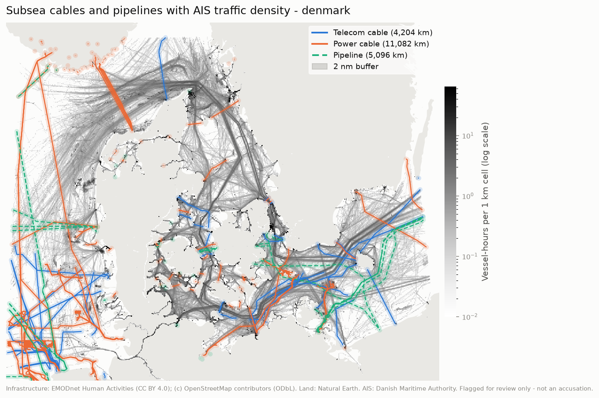
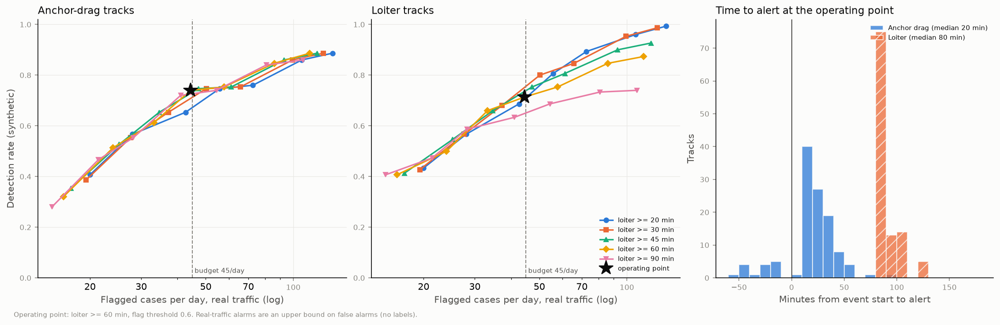
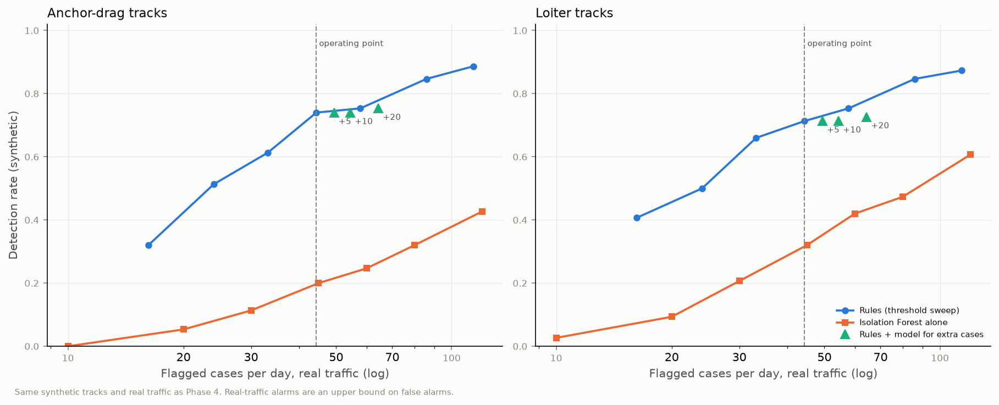

# Subsea Cable & Pipeline Guard

AIS-based monitoring that **flags vessel behaviour posing a risk to undersea cables and
pipelines for review by a human operator** (maritime security / critical-infrastructure
protection). The method is developed and evaluated on Danish/Baltic AIS data; the transfer
to the Aegean and Eastern Mediterranean is planned (Phase 6).

> Alerts are *flagged for review*, never accusations. See [ETHICS.md](ETHICS.md).

## Results at a glance (Denmark, DMA AIS 2025-06-02..06)

- **20,382 km** of mapped cables and pipelines (EMODnet + OpenStreetMap), 48.7 M AIS fixes,
  100k+ visits to 0.5/1/2 nm buffers; state vessels excluded.
- Four explainable rules (loiter, anchor-drag signature, AIS gap near asset, repeated passes)
  scaled by ship type, length, depth and zone; every flag carries a plain-language reason.
- Evaluated without labels on **300 synthetic events** injected into the real geography:
  at the chosen operating point (**~44 flagged cases/day**) **74 %** of anchor drags and
  **71 %** of loiters are flagged, drags **20 min** (median) after they start;
  **0 %** of vessels that only cross assets are flagged.
- The evaluation found and fixed two pipeline defects (a fast approach hid a slow drag; regime
  pieces counted as repeated passes); an independent re-run reproduced every number.
- An **Isolation Forest was tested and dropped**: 20 % vs 74 % drag detection at equal load, and
  extra alarms were better spent on the rules - a criterion fixed before the experiment.
- **Streamlit dashboard** with map, explained cases, track replay and a public-safe synthetic
  mode. Details and every metric: [RESULTS.md](RESULTS.md); limits: [LIMITATIONS.md](LIMITATIONS.md).



*Infrastructure layer (EMODnet + OpenStreetMap) over time-weighted AIS traffic density.*



*Evaluation without labels: detection of 300 synthetic events against the alarm load on real
traffic; the star is the chosen operating point (about 44 cases per day).*



*The unsupervised model found rare, not risky, behaviour and was dropped.*

More figures: [visit duration vs. speed](docs/figures/phase2_visits_1nm.png),
[case scores and triggering rules](docs/figures/phase3_cases.png).

## Status

| Phase | Content | Status |
|---|---|---|
| 0 | Real-time AIS collector (aisstream.io -> daily Parquet) | code and tests done; deployment with Phase 6 |
| 1 | Infrastructure layer (EMODnet + OSM cables/pipelines, buffers, density map) | Denmark done |
| 2 | Exposure per vessel track | Denmark done |
| 3 | Rule-based risk behaviours + explainable score | Denmark done (tuned in Phase 4) |
| 4 | Evaluation without labels (synthetic injection, false-alarm rate) | Denmark done |
| 5 | Optional unsupervised ML comparison | Denmark done - model dropped (no added value) |
| 6 | Regional transfer + receiver-coverage model (Aegean, Ionian, Eastern Med) | planned |
| 7 | Streamlit dashboard, demo | done (Denmark) |

## Setup

Requires Python >= 3.12 and [uv](https://docs.astral.sh/uv/).

```powershell
uv venv --python 3.14 .venv
uv pip install --python .venv\Scripts\python.exe -e ".[dev,geo,ml,viz]"   # full analysis
# the collector alone needs only ".[dev]"
.venv\Scripts\python.exe -m pytest
```

Secrets go in `.env` (git-ignored); copy `.env.example` and fill in `AISSTREAM_API_KEY`.
All regions, bounding boxes and thresholds are in [config/default.yaml](config/default.yaml).

## Phase 0 - AIS collector

There is no free historical AIS source for the Eastern Mediterranean, so the project
collects its own from the aisstream.io websocket stream.

```powershell
.venv\Scripts\python.exe -m cableguard collect --duration-s 120   # 2-minute test
.venv\Scripts\python.exe -m cableguard status                     # what has been stored
.venv\Scripts\python.exe -m cableguard collect                    # run until stopped
.\scripts\install_collector_task.ps1                              # run in background (Windows)
```

Design:
- Subscribes to Class A/B position reports and static data inside the configured bounding box
  (websocket compression on: uncompressed connections are bandwidth-limited).
- Every 60 s it writes a small Parquet *part* file (temp file + atomic rename), so a hard kill
  loses at most one minute. At UTC midnight the previous day's parts are merged into one daily
  file, duplicates removed, and the row count verified before the parts are deleted.
- Reconnects automatically with exponential backoff and jitter; a watchdog reconnects if no
  message arrives for 90 s.
- Logs a heartbeat every 5 minutes to `stats.jsonl` (uptime, fraction of time connected,
  reconnects, messages by type, rows written), so data completeness can be audited.
- A localhost-port lock prevents two collectors writing duplicate data.
- Stores messages as received; cleaning is a separate, documented step.

Output (git-ignored, under `private/eastmed/`):

```
ais/positions/2026-11-13.parquet          daily file (after compaction)
ais/positions/parts/2026-11-14/part-*.parquet   today, still being written
ais/static/...
logs/collector.log   logs/stats.jsonl
```

### Running on a cloud VM (Oracle Cloud Always Free)

For multi-week collection with the laptop switched off, the collector runs on a small
Linux VM (Ubuntu 24.04). It only makes outbound connections, so no inbound port other than
SSH is needed.

```bash
git clone git@github.com:<owner>/subsea-cable-guard.git && cd subsea-cable-guard
cp .env.example .env && nano .env      # add AISSTREAM_API_KEY
bash scripts/setup_vm.sh               # uv, venv, swap if <2 GB RAM, tests, systemd service
```

Finished daily files are copied to the laptop with
`.\scripts\pull_from_vm.ps1 -VmHost ubuntu@<ip> -Key <private key>` (only new files).

Caveat: Oracle may reclaim Always Free instances that stay idle (CPU p95, network and, for
A1, memory all below 20 % over 7 days). The collector is light, so the data is pulled to the
laptop regularly and the heartbeat log shows any interruption.

## Phase 1 - Infrastructure layer

```powershell
.venv\Scripts\python.exe -m cableguard infra-fetch --region denmark   # download & cache sources
.venv\Scripts\python.exe -m cableguard phase1 --region denmark        # layer, buffers, density, map
```

- Sources: EMODnet Human Activities (national authorities, *surveyed*) and OpenStreetMap
  submarine cables/pipelines (*community*). EMODnet coverage is national and patchy: in the
  Danish box it holds German and Norwegian cable data and the pan-European pipelines, but no
  Danish national cables; in the Eastern Mediterranean it holds no pipelines and only a few
  telecom cables. OSM fills part of the gap.
- Every geometry keeps its source, id and status (e.g. in use / out of use).
- Buffers (0.5 / 1 / 2 nm) are dissolved per asset type, which also removes double counting
  where two sources map the same cable. A source is only used for buffers at least as wide as
  its accuracy class allows (surveyed 0.5 nm, community 1 nm, schematic 2 nm).
- Point queries use an STRtree over the lines (exact point-to-line distance).
- Traffic density is time-weighted (vessel-hours per 1 km cell): each fix is credited with the
  time since the previous fix of its track segment, capped at 10 minutes, so frequent
  reporters are not over-counted.

## Phase 2 - Exposure of vessel tracks

```powershell
.venv\Scripts\python.exe -m cableguard bathy-fetch --region denmark   # EMODnet bathymetry (~460 m)
.venv\Scripts\python.exe -m cableguard phase2 --region denmark        # visits, classes, tables
```

- Unit of analysis: a **visit** = consecutive fixes of one track segment inside one buffer
  (asset type x width). Per visit: duration, speed statistics, minimum distance, the asset
  feature, angle between course and cable (0 = along, 90 = across), heading/COG difference,
  share of time with status *at anchor* or *moored*, longest reporting gap, water depth.
- Classes: **loiter** (>= 20 min with median SOG <= 3 kn), **crossing** (path, extended by one
  fix before and after, intersects the asset), **transit** (near but neither).
- State vessels (military, law enforcement, SAR) are excluded before analysis.
- Speed: lines are simplified (max 10 m deviation) and indexed as straight pieces of <= 1 km;
  a prepared union polygon rejects fixes far from all infrastructure. One bucket of ~3.4 M
  fixes went from >10 min to ~100 s with identical results.
- Per-visit and per-track tables contain MMSIs and stay in `data/` (git-ignored); only
  aggregated tables are written to `outputs/`.

## Phase 3 - Explainable risk rules

```powershell
.venv\Scripts\python.exe -m cableguard phase3 --region denmark
```

Rules run on visits of the 1 nm buffer (the narrowest width every source supports):

| Rule | Fires when | Supporting indicators (raise the score) |
|---|---|---|
| R1 loiter | >= 20 min at <= 3 kn | longer stay |
| R2 anchor-drag signature | 1-6 kn, steady (SOG IQR <= 2 kn), >= 20 min | status *at anchor* while moving; heading/COG difference >= 20 deg; slowed >= 4 kn in the 30 min before entry; moving along the asset |
| R3 AIS gap | a *dark* gap (good receiver coverage, not in port) starts or ends near an asset | reappeared elsewhere; both ends near |
| R4 repeated passes | >= 3 slow passes over the same asset within 24 h (scheduled ferries exempt) | each extra pass |

Each raw score is multiplied by a **context factor** = ship type x length x depth x zone
(port, routine anchorage, operating wind farm; the zone factor depends on the rule).
Alerts of one vessel, asset and day form a **case**: score = 1 - prod(1 - alert score),
flagged at >= 0.5. Every case carries a plain-language explanation of each alert and of
every context factor. All weights are in `config/default.yaml`; Phase 4 tunes them.

## Phase 4 - Evaluation without labels

```powershell
.venv\Scripts\python.exe -m cableguard phase4 --region denmark
```

- **Synthetic injection** (seed 42): 150 anchor-drag and 150 loiter tracks next to real
  assets in the real geography (10-100 m depth, outside ports, anchorages and operating wind
  farms). Each track approaches, performs the event, and leaves; it reports at realistic AIS
  intervals with noise. Indicators appear only with set probabilities (status *at anchor*
  60 %, sideways drift 60 %, speed drop 70 %, 15 % small vessels), so the set includes hard
  cases. Ground truth: the exact start and end of the risky behaviour.
- **Detection and time-to-alert**: synthetic tracks go through the unchanged Phase 2-3 code.
  Time-to-alert replays each track as if live: it is cut every 5 min from 60 min before to
  180 min after the event start and re-scored; the first flagged cut is the alert time.
- **False alarms**: flagged cases on the real traffic (assumed overwhelmingly benign, so an
  upper bound), per day and as the share of exposed ferries, fishing vessels and
  crossing-only vessels that get flagged.
- **Trade-off**: flag threshold 0.3-0.9 x loiter duration 20-90 min. The operating point is
  the highest mean detection within an operator budget of 20 flagged cases per day.
  It is reported, not written into the configuration automatically.

## Phase 5 - Optional ML layer (result: not kept)

```powershell
.venv\Scripts\python.exe -m cableguard phase5 --region denmark
```

An Isolation Forest (seed 42, 300 trees) is trained on the 45,276 real 1 nm visits outside
ports, anchorages and wind farms, on 11 features (duration, speeds, straightness, angle to the
asset, heading/COG difference, share *at anchor*, distance, depth, length, reporting gap).
Each anomalous visit is explained by its most extreme features. It is compared with the rules
on the Phase 4 synthetic tracks and real traffic: (1) alone at equal alarm load, (2) as a
filler for extra alarms versus simply lowering the rules' threshold. Decision rule: keep only
if it wins (2) by >= 2 percentage points. It did not; the code stays as a documented experiment
and is not part of the alert pipeline.

## Phase 7 - Dashboard

```powershell
.venv\Scripts\python.exe -m cableguard dashboard-data --region denmark   # pseudonymised data
.venv\Scripts\streamlit.exe run app/streamlit_app.py                    # http://localhost:8501
```

- **Overview**: key numbers, map of cables/pipelines (by type), 1 nm buffers, traffic density
  and cases.
- **Cases**: filter by rule and asset; each case shows why it was flagged (every alert and
  context factor) and a **track replay** with a time slider and a speed chart in UTC.
- **Evaluation**: trade-off curve, time to alert, rules vs. Isolation Forest.
- **Method and ethics**.
- Two modes: **Synthetic demo** (Phase 4 tracks with ground truth; safe for screenshots and the
  video) and **Real cases** (internal review only, with a warning banner).
- MMSIs never reach the app: `dashboard-data` replaces them with keyed pseudonyms
  (HMAC-SHA256 with the secret `MMSI_HASH_SALT`, or a private random salt in `data/`).
- The app binds to localhost only (`.streamlit/config.toml`).
- Demo video script: [docs/DEMO_SCRIPT.md](docs/DEMO_SCRIPT.md).

## Planned - Phase 6: Aegean, Ionian and Eastern Mediterranean

The collector (Phase 0) and the Oracle/Linux VM scripts are ready; the case study starts
once several weeks of data have been collected. Plan:

1. **Receiver-coverage model**: from the collected stream, where and when positions are
   normally received (cell x hour), so the tool reports "coverage gap" and "AIS switched off"
   separately - terrestrial volunteer receivers leave holes south of Crete and offshore.
2. **Infrastructure data gap**: EMODnet holds no pipelines and only 11 telecom features in the
   region box (vs. 222 in Denmark); OSM adds 87 ways. Options: TeleGeography (non-commercial,
   schematic - 2 nm buffer only) and national sources; the gap itself is a finding.
3. **Transfer**: the same pipeline (cleaning via the previous project's loader), the Danish
   operating point first, then a comparison of alarm load and behaviour between regions and an
   explanation of what had to change (thresholds, coverage, traffic patterns such as ferries
   and anchorages in the Saronic Gulf).
4. All data, results and figures stay in `private/` (git-ignored) until the owner decides.

## Reproduce everything (Denmark)

```powershell
.venv\Scripts\python.exe -m cableguard infra-fetch --region denmark
.venv\Scripts\python.exe -m cableguard phase1 --region denmark
.venv\Scripts\python.exe -m cableguard bathy-fetch --region denmark
.venv\Scripts\python.exe -m cableguard phase2 --region denmark    # ~20 min
.venv\Scripts\python.exe -m cableguard phase3 --region denmark
.venv\Scripts\python.exe -m cableguard phase4 --region denmark    # ~5 min
.venv\Scripts\python.exe -m cableguard phase5 --region denmark
.venv\Scripts\python.exe -m cableguard dashboard-data --region denmark
```

Input: the DMA AIS tracks cleaned and segmented by the previous project
(`maritime-ais-gnss`), read in place via `config/default.yaml`.

## Documentation

[RESULTS.md](RESULTS.md) - metrics per phase | [LIMITATIONS.md](LIMITATIONS.md) | [LICENSE](LICENSE) (MIT, code only) |
[DATA_LICENSES.md](DATA_LICENSES.md) | [ETHICS.md](ETHICS.md)
